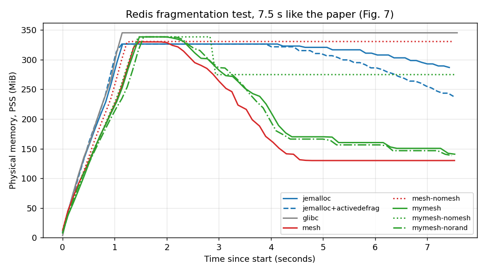
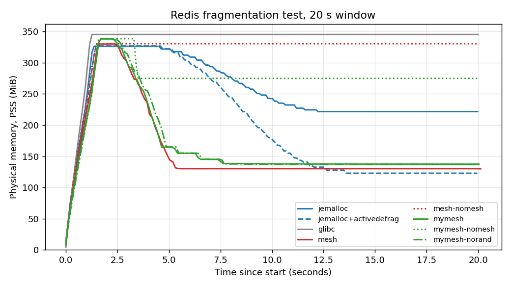
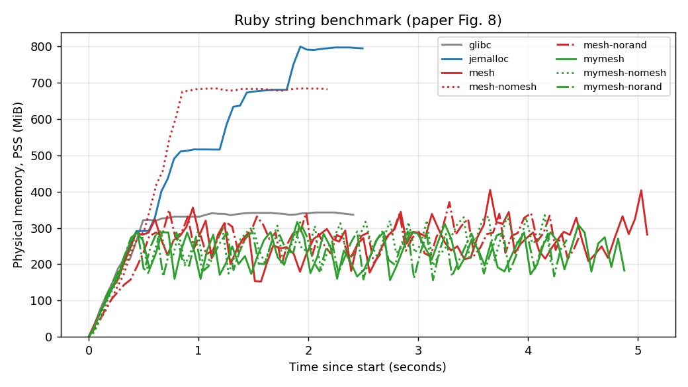
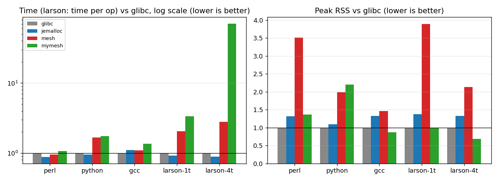

# Mesh (PLDI 2019): Implementation and Reproduction Report

Paper: *Mesh: Compacting Memory Management for C/C++ Applications*,
Bobby Powers, David Tench, Emery D. Berger, Andrew McGregor. PLDI 2019.

This report covers Phase 3 (our own implementation, `mymesh/`) and Phase 4
(reproducing the paper's experiments, `experiments/`).

---

## 1. Summary

| Claim in the paper | Original Mesh (their code, today) | mymesh (our code) | Reproduced? |
|---|---|---|---|
| Redis: Mesh saves memory automatically, about as much as Redis's own "activedefrag" (39%) | 55% less than jemalloc at 7.5 s; 41% less at 20 s. About the same as activedefrag at 20 s (130 vs 123 MiB) | 51% less at 7.5 s; 38% less at 20 s (138 MiB) | **Yes** |
| Mesh compacts faster than activedefrag | Mesh settles at ~5 s, activedefrag at ~13 s | mymesh settles at ~8 s | **Yes** |
| Insertion speed about the same as jemalloc (1.76 s vs 1.72 s) | 1.40 s vs 1.13 s (+24%) | 1.47 s (+30%) | **Partly** (slower than claimed) |
| Randomization is needed when the program frees in a regular pattern | No randomization: 0% saved; with it: 56% saved | No randomization: 0% saved; with it: 59% saved | **Yes** (controlled test) |
| Ruby benchmark: 19% smaller mean heap than no-randomization | Our rebuild of the benchmark: no difference (255 vs 256 MiB) | no difference (224 vs 225 MiB) | **No** (the paper's script is not public; see 5.2) |
| Runtime overhead is small (0.7% SPEC, 10.7% Ruby) | +100% on Ruby, +67% Python, +10% gcc, -5% Perl | +105% Ruby, +74% Python, +36% gcc, +7% Perl | **No** on allocation-heavy programs |
| Longest meshing pause 22 ms (Redis), total 0.23 s | not reported by the library | 105 ms longest, 1.2 s total | **No** (for our version) |

In short: the main idea works and the memory savings reproduce well, with
both their code and ours. The speed claims do not hold on this machine for
programs that call malloc very often.

---

## 2. What we built (Phase 3)

`mymesh/` is a drop-in `malloc` replacement written from scratch in C++
(about 1,300 lines including comments). It uses the original code only as a reference. It has
all 10 core features from `plan.md`:

| # | Feature | Where |
|---|---|---|
| 1 | Size classes, spans, bitmaps | `src/common.h`, `src/span.h`, `src/bitmap.h` |
| 2 | Random allocation (shuffle vector) | `src/shuffle_vector.h` |
| 3 | Heap backed by a memory file (`memfd_create`) | `src/arena.cc` |
| 4 | Meshing: copy objects, remap pages, free the old physical page | `Heap::meshPair` in `src/meshing.cc` |
| 5 | SplitMesher (finding pairs) | `Heap::meshSizeClass` in `src/meshing.cc` |
| 6 | Write barrier (`mprotect` + SIGSEGV handler) | `src/meshing.cc`, `src/wrapper.cc` |
| 7 | Address to span lookup | `src/arena.h` |
| 8 | Large objects (>16 KB) | `Heap::mallocLarge` |
| 9 | When to mesh (every 100 ms, on free and when idle in `epoll_wait`) | `Heap::maybeMesh` |
| 10 | Full malloc API through `LD_PRELOAD` | `src/wrapper.cc` |

Simplifications compared to the original: one global lock instead of
per-thread heaps, and fork() is only safe for the fork + exec pattern.

Tests (`make test` in `mymesh/`), all passing:

- `test_basic`: 400k random malloc/free/realloc/calloc/posix_memalign calls, all data checked, including after meshing.
- `test_threads`: 4 threads keep writing to their objects while meshing runs. Every write is accounted for, so the write barrier works.
- `test_frag`: fragmentation test with a memory and data check.
- Real programs: `ls`, a shell pipeline (fork + exec), Python, Redis, Ruby, Perl, gcc.

Things we added after the first version, found while running the experiments:

| Change | Reason |
|---|---|
| Mesh limit = 1/3 of `vm.max_map_count` | A fixed limit (20,000) stopped meshing early. The original reads the kernel limit. |
| At most 2,500 meshes per pass | Bounds the pause of one pass. Same as the original. |
| Keep up to 64 MB of freed pages for reuse ("dirty pages") | Returning every empty span to the OS cost one system call plus new page faults each time. Same as the original. |
| Faster random numbers | A 64-bit division (`%`) was the most expensive part of malloc in `perf`. |

---

## 3. Test setup

| Item | Value |
|---|---|
| CPU / RAM | x86_64, 18 cores, 15 GiB |
| OS | Manjaro Linux, kernel 6.12, glibc 2.44, gcc 16.2 |
| `vm.max_map_count` | 1,048,576 (the old default was 65,530) |
| Transparent huge pages | `always` (system default, not changed) |
| Original Mesh | git commit `fa1542b` (2026-10-21), built with cmake, Release |
| Mesh variants | normal, `-DDISABLE_MESHING=ON`, `-DRANDOMIZATION=0` |
| mymesh variants | normal, `MYMESH_NO_MESH=1`, `MYMESH_NO_RANDOM=1` |
| Redis | 7.2.6, built twice: with libc malloc (so `LD_PRELOAD` works) and with its bundled jemalloc (needed for activedefrag) |
| Ruby | 3.3.6 (`miniruby`) |
| jemalloc (for non-Redis tests) | system jemalloc 5.4.0 via `LD_PRELOAD` |

The paper used Redis 4.0.2, Ruby 2.5.1, jemalloc 3.6, glibc 2.26 on 2018 hardware.

### How we measure memory: PSS, not RSS

The paper measures memory with its own tool, `mstat`. We sample
`/proc/<pid>/smaps_rollup` and record both **RSS** and **PSS**.

After meshing, one physical page is mapped at two or more virtual
addresses. **RSS counts that page once per mapping**, so it over-counts
meshed memory. **PSS** splits a shared page between its mappings, so each
physical page counts once. For allocators that don't mesh, RSS and PSS are
almost equal. Example from Redis (7.5 s, final): original Mesh RSS = 181 MiB
but PSS = 130 MiB. All memory numbers below are PSS.

Sampling every 10 ms slowed Redis down (reading `smaps_rollup` locks the
process's memory map), so Redis is sampled every 100 ms and Ruby every 50 ms.

---

## 4. Redis experiment (paper section 6.2.2, Figure 7)

**Setup (same as the paper):** Redis as an LRU cache with `maxmemory 100mb`.
Insert 700,000 keys with 240-byte values, then 170,000 keys with 492-byte
values (`DEBUG POPULATE`). The second batch makes Redis evict old keys,
which leaves holes all over the heap. Measure memory for 7.5 s.
"jemalloc+activedefrag" turns on Redis's own defragmenter after the inserts,
with the settings from Redis's own test.

**One change:** Redis 7 evicts keys gradually (Redis 4 evicted them in one
step), and activedefrag needs more than 7.5 s. So we also ran a 20 s window.

Script: `experiments/redis_frag.py`.

### Results

At the end, Redis holds exactly 100 MiB of live data in every run.

| Config | 7.5 s: mean | 7.5 s: final | 20 s: mean | 20 s: final | Insert time |
|---|---|---|---|---|---|
| jemalloc (Redis default) | 292 | 287 | 253 | 222 | 1.13 s |
| jemalloc + activedefrag | 283 | 238 * | 197 | **123** | 1.07 s |
| glibc | 317 | 345 | 334 | 345 | 1.12 s |
| **original Mesh** | **188** | **130** | **157** | 130 | 1.40 s |
| original Mesh, no meshing | 301 | 331 | 319 | 330 | 1.24 s |
| **mymesh** | 208 | 141 | 165 | 137 | 1.47 s |
| mymesh, no meshing | 265 | 275 | 271 | 275 | 1.42 s |
| mymesh, no randomization | 205 | 138 | 166 | 137 | 1.53 s |

Memory in MiB (PSS). * Activedefrag had not finished by 7.5 s.




### What this shows

- **The main claim holds.** Both Mesh versions cut Redis's memory roughly in
  half compared to jemalloc, with no change to Redis. The paper reports 39%.
- **Mesh compacts faster than activedefrag:** Mesh is done at ~5 s,
  activedefrag at ~13 s. Given enough time, activedefrag ends slightly lower
  (123 vs 130 MiB). The paper only shows the first 7.5 s, where Mesh looks
  better than activedefrag.
- **Randomization doesn't matter for Redis**: "no randomization" saves just
  as much. The paper says the same: Redis frees in an effectively random order.
- **Meshing cost:** mymesh did about 43,000 meshes in 1.2 s total, with the
  longest pass at 105 ms. The paper reports 0.23 s total and 22 ms longest for
  the original. Each mesh needs three system calls (`mprotect`, `mmap`,
  `fallocate`) at about 8 µs each on this machine.
- **Insertion is ~25-30% slower** with either Mesh version (paper: 2%).

---

## 5. Randomization experiments (paper section 6.3)

### 5.1 Controlled test: regular vs random free pattern

`mymesh/tests/test_frag`: allocate 2,000,000 objects of 64 bytes, free 90%,
then run meshing passes until nothing more is found.

- **random:** free a random 90%.
- **stride:** keep only every 8th object. With a normal (sequential)
  allocator, every page then keeps live objects at *the same slots*, so no
  two pages can be meshed. This is the case the paper uses to argue for
  randomization.

| Config | random: after | stride: after |
|---|---|---|
| glibc | 168 | 168 |
| jemalloc | 140 | 140 |
| original Mesh | 77 | 63 |
| original Mesh, no randomization | 77 | **143** (nothing saved) |
| mymesh | **52** | **58** |
| mymesh, no randomization | 52 | **143** (nothing saved) |
| mymesh, no meshing | 143 | 143 |

Memory in MiB (PSS) after freeing. Live data: 12 MiB (random), 15 MiB (stride). Before freeing: 137 to 168 MiB.
All data was checked after meshing: no errors. Script: `experiments/microbench.py`.

**This reproduces the paper's argument exactly, with both implementations.**
With a regular pattern, meshing without randomization saves nothing, and
with randomization it cuts memory by more than half.

### 5.2 Ruby benchmark (paper Figure 8)

The paper's Ruby script is not public, so we rebuilt it from the text
(`experiments/ruby/strings.rb`): allocate 128 MB of strings, keep every 4th
one (25%), drop the rest, double the string length, repeat. The kept
strings live through the next round and are then dropped, so live data
stays at about 128 + 32 MB.

Changes we had to make:
- Ruby 3.3 keeps strings under ~600 bytes inside its own heap (Ruby 2.5 sent
  everything over 23 bytes to malloc), so lengths start at 1,000 bytes:
  1000, 2000, 4000, 8000, 16000.
- One sequence takes under 1 s today, so we repeat it 4 times to get close
  to the paper's ~3 s run.

| Config | Mean memory (PSS) | Peak | Time |
|---|---|---|---|
| glibc | 295 | 343 | 2.12 s |
| jemalloc | 521 | 799 | 2.40 s |
| **original Mesh** | 255 | 405 | 4.81 s |
| original Mesh, no meshing | 510 | 684 | 2.24 s |
| original Mesh, no randomization | 256 | 371 | 4.38 s |
| **mymesh** | **224** | 317 | 4.92 s |
| mymesh, no meshing | 243 | 335 | 4.24 s |
| mymesh, no randomization | 225 | 315 | 4.44 s |



- **Meshing helps a lot against jemalloc** (original Mesh: 51% less memory).
- **Randomization made no difference here**, unlike the paper (19%).
  Ruby's GC frees strings in heap order, not allocation order, and freed
  slots get reused by the next round, so the pattern seen by the allocator
  is not regular enough. The controlled test (5.1) shows the effect clearly.
  Without the original script we can't say what made their version regular.
- **Time doubles** with either Mesh version (paper: +10.7%), mostly system
  time spent returning memory to the OS and taking new page faults.
  glibc is both fast and small here because it merges freed chunks and
  reuses them for larger strings.

---

## 6. Speed on allocation-heavy programs (instead of SPEC)

The paper uses SPECint2006, which is paid software. We used free programs
with similar behavior (`experiments/overhead.py`, median of 3 runs):

| Program | glibc | jemalloc | original Mesh | mymesh |
|---|---|---|---|---|
| perl (perlbench-like mail filter) | 2.51 s | 2.21 s | 2.39 s | 2.69 s |
| python (dict/list/string churn + JSON) | 4.80 s | 4.57 s | 8.01 s | 8.34 s |
| gcc -O2 on Ruby's `parse.c` | 9.55 s | 10.59 s | 10.45 s | 12.95 s |
| larson, 1 thread (M ops/s, higher is better) | 21.6 | 23.5 | 10.6 | 6.5 |
| larson, 4 threads (M ops/s) | 57.5 | 64.8 | 20.5 | **0.8** |



- **Perl and gcc** (closest to the paper's SPEC programs): Mesh is within 10%
  of glibc, as the paper says.
- **Python and larson**, which call malloc much more often, run about 1.7 to 2.8x
  slower with the original Mesh.
- **mymesh with 4 threads is ~70x slower than glibc**: all threads wait on
  our single global lock. This is the price of dropping the per-thread heaps
  (a known limit of our version, not of the paper's design).
- Peak memory (right-hand plot) comes from the kernel's peak RSS, which
  over-counts meshed pages (section 3), so it makes Mesh look worse than it is.

---

## 7. Issues and differences found

1. **RSS over-counts meshed memory.** Tools like `top`, `ps`, and container
   memory limits based on RSS will show much smaller savings than Mesh
   actually gives (Redis: 181 MiB RSS vs 130 MiB PSS). The paper does not
   discuss this.
2. **The mapping limit matters a lot.** Mesh uses up to 1/3 of
   `vm.max_map_count`. Redis needed ~43,000 meshes. With the old default
   limit (65,530, still common on Ubuntu/Debian) only ~21,000 are allowed,
   so savings would be capped. Not tested in the paper.
3. **Bug in the original:** built with `-DDISABLE_MESHING=ON`, calling
   `mesh_mallctl("mesh.compact")` aborts with `ASSERTION '_fd >= 0' FAILED`
   (`meshable_arena.h:842`).
4. **API quirk in the original:** `mesh_mallctl("mesh.compact", NULL, NULL, NULL, 0)`
   silently does nothing and returns -1. You must pass an output buffer even
   though compact returns nothing.
5. **Mesh does not lower peak memory**, only memory after frees (the peak is
   the same for all allocators in Redis). Programs whose limit is their
   peak gain nothing.
6. **Speed overhead is much higher than reported** on malloc-heavy programs
   (Ruby 2x, Python 1.7x, larson 2-3x), on a modern kernel.
7. **Meshing pauses** (our version): up to ~105 ms, because each mesh costs
   three system calls. Batching them is an obvious improvement.
8. **Redis 7 behaves differently from Redis 4**: eviction is gradual and
   activedefrag eventually matches or beats Mesh if given ~13 s.
9. **Randomization only helped in the controlled test**, not in Redis or in
   our Ruby rebuild.

Not done: **Firefox** (too large to build on this machine with ~1 GB free
disk) and **SPEC CPU2006** (paid software; replaced by section 6).

---

## 8. How to reproduce

```sh
cd Presentations/p2
git clone https://github.com/plasma-umass/Mesh reference/Mesh   # original code (not in this repo)
sh experiments/setup.sh          # builds Redis, Ruby, Mesh variants, larson, mymesh (~10 min)
cd mymesh && make test && cd ..  # our allocator's tests
cd experiments
python3 redis_frag.py                     # Redis, 7.5 s window
REDIS_DURATION=20 python3 redis_frag.py   # Redis, 20 s window
python3 ruby_strings.py
python3 microbench.py
python3 overhead.py
python3 plot.py                           # figures into experiments/results/
```

Big builds go into a scratch folder in RAM (set `BUILD=...` to change it),
because the project disk is almost full. A reboot clears them; rerun
`setup.sh`.

## 9. Files

| Path | What |
|---|---|
| `plan.md` | Project plan and feature list |
| `mymesh/` | Our implementation (see `mymesh/README.md`) |
| `reference/Mesh/` | Original code (cloned), paper PDF inside |
| `experiments/common.py` | Allocator configs and memory sampler |
| `experiments/redis_frag.py` | Redis experiment |
| `experiments/ruby_strings.py`, `ruby/strings.rb` | Ruby experiment |
| `experiments/microbench.py` | Controlled random/stride test |
| `experiments/overhead.py`, `overhead/` | Speed tests |
| `experiments/plot.py` | Figures |
| `experiments/setup.sh` | Builds everything |
| `experiments/results/` | Raw CSV/JSON data and figures |
